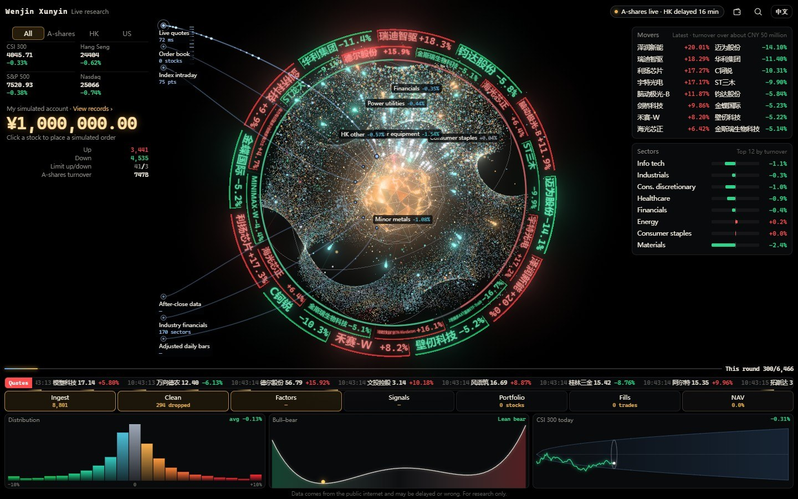

# Wenjin Xunyin (问金寻银)

English | [中文](README.md)

A real-time market board for China A-shares, Hong Kong stocks and US stocks. More than 8,000 stocks are laid out as one 3D nebula: every stock is a dot, sized by its turnover (value traded) and coloured by its price change (red is up and green is down, following the Chinese market convention). Quotes come from public sources. Dots light up batch by batch as quotes arrive, and a stock with no data stays dark: nothing is filled in with made-up numbers.



The interface is available in Chinese and English. Switch with the button at the top right (on phones, the link at the bottom of the page), or add `?lang=en` / `?lang=zh` to the address. Stock names are shown as the data source provides them, which is in Chinese.

- **Nebula:** clustered by industry. Drag to rotate, scroll or pinch to zoom. Click a dot to see that stock's quote, five-level order book and daily candlestick chart.
- **Markets:** switch between All, A-shares, Hong Kong and US. The main indices are at the top, and the outer ring shows the biggest gainers and losers.
- **Price-change distribution, bull/bear potential, volatility funnel:** three small panels that refresh with the live data.
- **Simulated accounts:** three separate accounts, in CNY, HKD and USD. Simulated trades fill against the real order book and apply lot sizes, the A-share T+1 rule (shares bought today cannot be sold until the next trading day), commission and stamp duty. (US quotes come without an order book, so the five levels are not shown and fills are estimated at the latest price.)
  - You can review holdings, trade history, orders, profit and loss per stock, and a daily reconciliation.
  - The accounts are stored only in your own browser. No broker is connected and no real money is involved.
- **Basket:** put a few stocks together, place simulated trades for all of them at once, and compare how they move.

> Data comes from the public internet and may be delayed or wrong. For research only, not investment advice.

## Run

You only need Python 3.9 or later. There is nothing else to install.

On the first run, build the stock list (it takes a minute or two; refreshing it once a day is enough):

```bash
python tools/update_universe.py
```

Then start the local server:

```bash
python server.py
```

Open <http://127.0.0.1:8765/> in a browser. To use another port: `python server.py 8800`.

- The server listens on 127.0.0.1 only, so other devices on the same network cannot reach it.
- You need a browser with WebGL (a current Chrome, Edge, Firefox or Safari). The page also works at phone width.
- The quote endpoints are in mainland China. If a system proxy is set, it is bypassed by default; set the environment variable `WENJIN_USE_PROXY=1` to go through the proxy.

## Usage

- Click a dot in the nebula, a label on the outer ring, or a row in the list on the right to open the stock card. The magnifier at the top right searches by name or code.
- In the stock card you can place a simulated buy or a simulated sell, or add the stock to the basket. Orders placed after the close are queued and filled at the real opening price of the next trading day.
- `Esc` goes back one level in the side panel.
- Deep links: `?open=stock&code=sh600519` opens a stock, and `?open=account&market=US&tab=trades` opens the trade history of the USD account.

## Data

| Path | Contents | Required |
|---|---|---|
| `data/universe.json` | Stock list: code, name, industry, turnover | Yes. Generate it with `tools/update_universe.py` |
| `data/history.json` + `history.bin` | Recent daily price-change matrix, used for the after-close replay and factor IC (information coefficient) | No. Without it there is no replay |
| `data/rules.json` | Signals and backtests computed from your own screening rules | No. Without it no signals are shown |

The formats of the optional files are described in [docs/data-format.en.md](docs/data-format.en.md). None of these files are included in the repository.

### Data sources

- **Live quotes, intraday prices and daily candlesticks:** Tencent's public web quote endpoints (`qt.gtimg.cn`, `web.ifzq.gtimg.cn`), forwarded locally by `server.py`. Stock codes are validated against an allow-list pattern.
- **Stock list and industry classification:** Eastmoney's public quote-list endpoint (`push2.eastmoney.com`), fetched by `tools/update_universe.py`.
  - All A-shares are included. For Hong Kong and US stocks, the script takes the top 600 and top 2,100 by turnover, respectively (change this with `--hk` and `--us`).
  - This endpoint has anti-abuse limits. The script fetches one page at a time, slowly, and stops when it gets a 403 or the connection drops; wait 30 to 60 minutes before trying again. The existing list is not overwritten until everything has been fetched.

## Notes

- **Third-party data:** all of the above are unofficial public web endpoints of third-party sites. This project is not affiliated with Tencent or Eastmoney, and is not authorised or endorsed by them.
  - These endpoints come with no guarantees. They may change, be rate-limited or be shut down at any time, and the board may stop working as a result.
  - Follow each provider's terms of use, use the data for personal study and research only, and do not send requests at a high rate. For commercial or high-frequency use, switch to a licensed data source.
- **Not investment advice:** the board only shows quotes and simulated results. Simulated fills are estimated from the public order book or the latest price, and will differ from real executions.
- **Privacy:** the board does not collect or upload any data. The simulated accounts and the basket are stored in the browser's localStorage and are gone once you clear the site data. The page's Content Security Policy (CSP) only allows connections to the local server.

## Layout

```
server.py                 Local server: page, data, quote forwarding (standard library only)
tools/update_universe.py  Builds / refreshes the stock list
web/                      The page (rendered with three.js, WebGL)
  nebula-i18n.js            Interface language (Chinese / English) and the switch
  nebula-lang-en.js         English strings, keyed by the Chinese source text
  nebula-core.js            Quote parsing, validation, trading sessions, nebula layout (pure logic; can be require()d in Node)
  nebula-sim.js             Simulated trading engine (pure logic; money is integer cents)
  nebula-scene.js           3D scene
  nebula-app.js             Main logic and interface
data/                     Data (not in the repository)
docs/                     Data formats, screenshot
```

The page has no build step. Edit a file and refresh the browser.

## License

[Apache License 2.0](LICENSE). Copyright and third-party notices are in [NOTICE](NOTICE).

The page uses [three.js](https://threejs.org/) r160, which is MIT-licensed. It is bundled unmodified as `web/three.module.min.js`, and its license is in `web/THREE-LICENSE.txt`.
