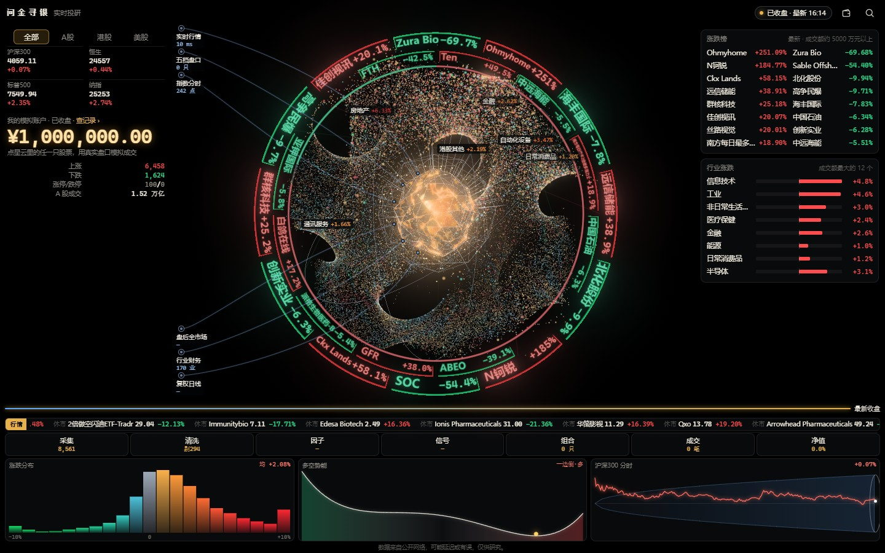

# 问金寻银（Wenjin Xunyin）

[English](README.en.md) | 中文

A 股、港股、美股的实时行情看板。8,000 多只股票排成一团三维星云：每只股票是一颗光点，大小随成交额变，颜色随涨跌变（涨红跌绿）。行情来自公开报价，到一批点亮一批，没到的就是暗的，不画假的行情。



- **星云：** 按行业成簇，拖动旋转，滚轮或双指缩放。点一颗星看这只股票的报价、五档盘口和日 K。
- **市场：** 全部 / A 股 / 港股 / 美股切换，顶部是主要指数，外圈是涨跌榜。
- **涨跌分布、多空势能、波动漏斗：** 三个小面板跟着实时数据刷新。
- **模拟账户：** 人民币、港币、美元三本账，按真实盘口、手数、T+1、佣金和印花税模拟买卖（美股行情没有盘口，不显示五档，按最新价估算成交）。
  - 能查持仓、买卖记录、委托、个股盈亏和每日对账；
  - 账本只存在你自己的浏览器里，不连券商，不涉及真实资金。
- **篮子：** 挑几只放一起，一起模拟买卖、对照涨跌。
- **中文 / English：** 界面有中文和英文两种，右上角切换（手机上在页面底部），也可以在地址后面加 `?lang=en` / `?lang=zh`。股票名称按数据来源显示，是中文。

> 数据来自公开网络，可能延迟或有误，仅供研究，不构成任何投资建议。

## 运行

只需要 Python 3.9 以上，不装任何依赖。

第一次运行先生成股票名单（一两分钟，之后一天更新一次就够）：

```bash
python tools/update_universe.py
```

再启动本机服务：

```bash
python server.py
```

浏览器打开 <http://127.0.0.1:8765/>。换端口：`python server.py 8800`。

- 服务只监听本机 127.0.0.1，同一局域网的其他设备也访问不到。
- 需要支持 WebGL 的浏览器（新版 Chrome、Edge、Firefox、Safari 都可以），手机宽度也能用。
- 行情接口在国内：系统开了代理时默认直连，要走代理先设环境变量 `WENJIN_USE_PROXY=1`。

## 用法

- 点星云里的光点、外圈的涨跌榜标签或右侧榜单，打开个股卡片；右上角放大镜按名称或代码查找。
- 个股卡片里可以模拟买入、模拟卖出、加入篮子；收盘后下的单排队，下一交易日按真实开盘价成交。
- `Esc` 退回抽屉的上一层。
- 地址参数直达：`?open=stock&code=sh600519` 打开一只股票，`?open=account&market=US&tab=trades` 打开美元账户的买卖记录。

## 数据

| 路径 | 内容 | 必需 |
|---|---|---|
| `data/universe.json` | 股票名单：代码、名称、所属行业、成交额 | 是，用 `tools/update_universe.py` 生成 |
| `data/history.json` + `history.bin` | 收盘后回放、因子 IC 用的近期日涨跌矩阵 | 否，没有就不回放 |
| `data/rules.json` | 你自己的选股规则算出的信号和回测 | 否，没有就不显示信号 |

可选数据的格式见 [docs/data-format.md](docs/data-format.md)。仓库里不附带这些文件。

### 数据来源

- **实时报价、分时、日 K：** 腾讯行情的公开网页接口（`qt.gtimg.cn`、`web.ifzq.gtimg.cn`），由 `server.py` 在本机转发，股票代码按白名单校验。
- **股票名单和行业分类：** 东方财富的公开行情列表接口（`push2.eastmoney.com`），由 `tools/update_universe.py` 拉取。
  - A 股全部；港股、美股按成交额各取前 600 / 2100 只（`--hk`、`--us` 可改）。
  - 这个接口有风控：脚本一页一页慢慢取，遇到 403 或连接断开就停，过 30 到 60 分钟再试。全部取完以前不会覆盖原来的名单。

## 说明

- **第三方数据：** 以上都是第三方网站的非官方公开网页接口，本项目与腾讯、东方财富没有任何关联，也没有得到它们的授权或认可。
  - 这些接口没有公开承诺，随时可能变化、限流或停用，看板可能因此用不了。
  - 使用时请遵守各数据提供方的使用条款，只作个人学习研究，不要高频请求；需要商用或高频使用时，请改接有授权的数据源。
- **不构成投资建议：** 看板只展示行情和模拟结果。模拟成交按公开盘口或最新价估算，和真实成交会有差别。
- **隐私：** 看板不收集、不上传任何数据。模拟账户和篮子存在浏览器的 localStorage 里，清除网站数据就没了。页面的内容安全策略（CSP）只允许连本机服务。

## 目录

```
server.py                 本机服务：页面、数据、行情转发（只用标准库）
tools/update_universe.py  生成 / 更新股票名单
web/                      页面（three.js 渲染，WebGL）
  nebula-i18n.js            界面语言（中文 / English）和切换
  nebula-lang-en.js         英文对照表：中文原句 → 英文
  nebula-core.js            行情解析、校验、交易时段、星云布局（纯逻辑，可在 Node 里 require）
  nebula-sim.js             模拟交易引擎（纯逻辑，金额按“分”整数运算）
  nebula-scene.js           三维场景
  nebula-app.js             主逻辑和界面
data/                     数据（不进仓库）
docs/                     数据格式、截图
```

页面没有构建步骤，改完刷新浏览器即可。

## 许可证

[Apache License 2.0](LICENSE)，版权和第三方声明见 [NOTICE](NOTICE)。

页面用到的 [three.js](https://threejs.org/) r160 是 MIT 许可，原样附在 `web/three.module.min.js`，许可证见 `web/THREE-LICENSE.txt`。
